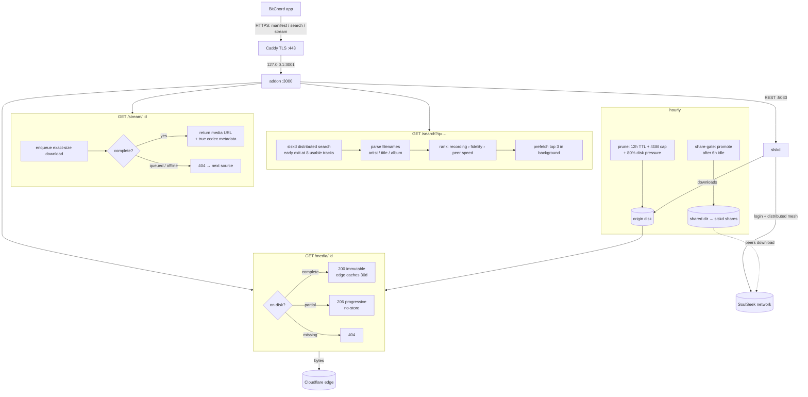

# soulseek-addon — BitChord addon for the SoulSeek network

BitChord talks to 3 `GET` routes on this server (`/manifest.json`, `/search`, `/stream/:id`).
SoulSeek has no HTTP API, so this server is a **gateway**: it logs into SoulSeek via
**slskd** (headless daemon — no desktop app needed) and serves the bytes back over HTTPS.

## How it works



**One play, end to end:**

1. **Discover** — BitChord reads `/manifest.json` (addon id, resources, quality settings).
2. **Search** — `GET /search?q=…&quality=…` fans out to the SoulSeek distributed
   network via slskd (`POST /api/v0/searches {searchText}`, polled to completion,
   early exit at 8 usable tracks). Empty phrasing retries distinctive words
   automatically. Identical concurrent queries share one slskd search.
3. **Rank** — filenames are parsed path-aware (`Artist/Album/01 Title`,
   track-number stripping, quality-tag cleanup, never numeric "artists"), then
   ordered: exact recording → fidelity (hi-res lossless › ALAC › FLAC › HIGH by
   real bitrate › LOW) → peer speed (free upload slot first). Bitrates SoulSeek
   never reports are derived from file size ÷ duration, so every row carries an
   honest, BitChord-recognized tier — which is what lets lossless upgrades win.
4. **Prefetch** — the top 3 hits start downloading in the background immediately,
   so tapping play usually finds bytes already flowing.
5. **Stream** — `GET /stream/{id}` enqueues the peer download (exact byte size
   required — slskd aborts on mismatch), waits for the *complete* file (deep
   queues fail fast to 404 so BitChord moves on), and returns an absolute media
   URL plus true codec/container/sample-rate/bit-depth/bitrate metadata.
6. **Play** — `GET /media/:id` serves bytes with Range + HEAD + correct MIME.
   Complete files send `Cache-Control: public, immutable` (edge caches them);
   partials send `no-store` (the edge must never learn a truncated song).

**Caching, layer by layer** (each layer only sees misses from the one above):

| Layer | What | TTL |
|---|---|---|
| BitChord app | search 10 min, stream 5 min | client-side |
| Addon memory | search hits, stream bodies | 10 / 5 min (empties never cached) |
| Origin disk | downloaded files | 12h idle + 4GB cap + 80% disk-pressure eviction (`deploy/prune.sh`, hourly) |
| Cloudflare edge | immutable `/media/*` | 30d + tiered PoPs |

**Sharing (SoulSeek → network):** optional and currently ON for the downloads
cache. Fresh downloads can be quarantined first (`deploy/share-gate.sh` promotes
only files idle past `SHARE_DELAY_HOURS` into `/shared/`; playback is unaffected
either way). One login per client — two simultaneous logins as the same user
kick each other off, so give every deployment its own SoulSeek account.

**Failure semantics (all deliberate):** unknown track → `404` (next source);
peer queued/offline → `404`; slskd throttled → `429 + Retry-After` (BitChord
backs off); empty search → `200 []` (soft miss). Nothing ever 500s on P2P flakiness.

**Typical timing:** search 3–5s warm (distributed physics + early exit), stream
~2s warm / ~10s cold first fetch, media bytes edge-fast (`HIT`) after first play.

## Do I need SoulSeek installed?

**Short: something must stay logged into SoulSeek, but not the desktop app.**

- SoulSeek is a logged-in P2P network. There is no public/anonymous search API.
- This repo runs in **mock mode** with zero SoulSeek setup (for BitChord wiring tests).
- For real results, run **slskd** (one Docker container or binary) with your SoulSeek
  username/password, then point this addon at it. That's it.

## Quickstart (mock — no SoulSeek, 30s)

```bash
node src/server.js
# GET /manifest.json, /search?q=midnight, /stream/mock_midnight_signal
npm test
```

Add `http://localhost:3000/manifest.json` in BitChord: Settings → Sources.
(Mock streams are public sample MP3s so playback works before SoulSeek is wired.)

## Real mode (slskd)

1. Create a SoulSeek account (any client) — slskd needs `username + password`.
2. `cp .env.example .env`, fill `SLSKD_URL`, `SLSKD_API_KEY`, `PUBLIC_BASE_URL=https://<your-host>`.
3. `docker compose up -d` (slskd + addon, shared `downloads/` volume).
4. Add `https://<your-host>/manifest.json` in BitChord.

Flow: `BitChord → /search → slskd POST /api/v0/searches {searchText} → poll responses →
/stream/:id → slskd download → serve /media/:id (Range-capable)`.

## Notes / limits

- Search waits `SEARCH_TIMEOUT_MS` (default 8s) for the distributed network — slower than
  normal addons. Empty results = soft miss, BitChord tries the next source.
- Peer offline/queued → `/stream` returns `404` → BitChord falls through. Correct behavior.
- Quality is reported honestly from the shared file (no fake lossless badges).
- slskd API shape drifts between versions; version-specific code is isolated in
  `src/slskd.js → enqueueDownload()`. File serving reads the shared `DOWNLOAD_DIR`.
- BitChord requires HTTPS + absolute URLs in production.

## Edge cache (Cloudflare, branch `cf-edge-cache`)

`/media/:id` sends completeness-gated headers so a CDN can offload repeats:

- Complete file → `Cache-Control: public, max-age=31536000, immutable` (safe: one id = one immutable file)
- Still-downloading file → `Cache-Control: no-store` (never poison the edge with truncated audio)

Dashboard setup (2 min, Cloudflare free tier):

1. Cache Rule: host = your addon host, path `/soulseek/media/*` (adjust prefix to yours)
   → Cache Everything, Edge TTL ~1 month
2. Turn on Tiered Cache (Smart) so one PoP's fetch serves all regions
3. Verify: `curl -I <media-url>` twice → second response has `CF-Cache-Status: HIT`

Notes: first fetch per region still pays SoulSeek time; free-tier edge eviction is
best-effort (rare tracks re-fetch from origin — covered by the local download cache);
per-file cap is 512MB (fine for audio). Keep `INCOMPLETE_DIR` as a separate directory
from `DOWNLOAD_DIR` so completed files skip the per-request slskd check.

## Origin disk (pairs with edge cache)

Edge caching doesn't shrink origin disk by itself — evicted edge copies re-fetch
from origin. The fix: with edge repeats absorbing replays, drop the origin TTL.
`deploy/prune.sh` (daily via `deploy/soulseek-prune.timer`) deletes files neither
read nor written in `TTL_HOURS` (default 48) plus a `MAX_MB` safety cap (default 4096):

```bash
# /root/soulseek-addon/prune.env — with edge cache on, 12h keeps origin tiny:
TTL_HOURS=12
MAX_MB=4096
```

Set `TTL_HOURS` in `prune.env`, install the timer from `deploy/`, done.

## Share stopper (quarantine gate)

Fresh downloads are NOT shared immediately. `deploy/share-gate.sh` (same hourly
timer, runs before prune) moves files from staging (`downloads/`) to the stable
share dir (`shared/`) only after `SHARE_DELAY_HOURS` (default 24) with no reads
or writes — and never touches slskd's `incomplete/` area. Playback is unaffected
(the addon serves staging instantly); only SoulSeek-network sharing is gated.

Setup: `shared:/shared` is already in `docker-compose.yml` (both services).
Point slskd shares at `/shared` instead of `/downloads`:

```yaml
shares:
  directories:
    - /shared
```

Keep `TTL_HOURS` > `SHARE_DELAY_HOURS` or files prune before ever being shared.
The stable dir gets its own retention (`SHARED_TTL_HOURS`, default 720h).
