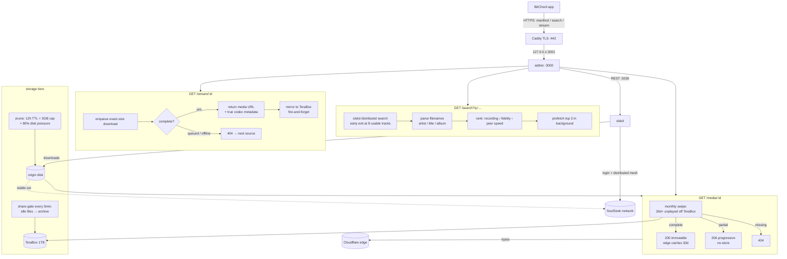

# soulseek-addon — BitChord addon for the SoulSeek network

BitChord talks to 3 `GET` routes on this server (`/manifest.json`, `/search`, `/stream/:id`).
SoulSeek has no HTTP API, so this server is a **gateway**: it logs into SoulSeek via
**slskd** (headless daemon — no desktop app needed) and serves the bytes back over HTTPS.

## How it works



**One play, end to end:**

1. **Discover** — BitChord reads `/manifest.json` (addon id, resources, quality settings).
2. **Search** — `GET /search?q=…&quality=…` fans out to the SoulSeek distributed
   network via slskd (`POST /api/v0/searches {searchText}`, polled to completion,
   early exit at 8 usable tracks). Empty phrasing retries distinctive words
   automatically. Identical concurrent queries share one slskd search.
3. **Rank** — filenames are parsed path-aware (`Artist/Album/01 Title`,
   track-number stripping, quality-tag cleanup, never numeric "artists"), then
   ordered: exact recording → fidelity (hi-res lossless › ALAC › FLAC › HIGH by
   real bitrate › LOW) → peer speed (free upload slot first). Bitrates SoulSeek
   never reports are derived from file size ÷ duration, so every row carries an
   honest, BitChord-recognized tier — which is what lets lossless upgrades win.
4. **Prefetch** — the top 3 hits start downloading in the background immediately,
   so tapping play usually finds bytes already flowing.
5. **Stream** — `GET /stream/{id}` enqueues the peer download (exact byte size
   required — slskd aborts on mismatch), then races up to 3 same-recording
   peers and returns the first complete file (deep queues fail fast to 404 so
   BitChord moves on), with true codec/container/sample-rate/bit-depth/bitrate
   metadata. Played streams mirror instantly to the archive tier.
6. **Play** — `GET /media/:id` serves bytes with Range + HEAD + correct MIME.
   Complete files send `Cache-Control: public, immutable` (edge caches them);
   partials send `no-store` (the edge must never learn a truncated song).

**Caching, layer by layer** (each layer only sees misses from the one above):

| Layer | What | TTL |
|---|---|---|
| BitChord app | search 10 min, stream 5 min | client-side |
| Addon memory | search hits, stream bodies | 10 / 5 min (empties never cached) |
| Origin disk | downloaded files | 12h idle + 4GB cap + 80% disk-pressure eviction (`deploy/prune.sh`, event-driven via monitor) |
| Cloudflare edge | immutable `/media/*` | 30d + tiered PoPs |

**Sharing (SoulSeek → network):** optional and currently ON for the downloads
cache. Fresh downloads can be quarantined first (`deploy/share-gate.sh` promotes
only files idle past `SHARE_DELAY_HOURS` into `/shared/`; playback is unaffected
either way). One login per client — two simultaneous logins as the same user
kick each other off, so give every deployment its own SoulSeek account.

**Failure semantics (all deliberate):** unknown track → `404` (next source);
peer queued/offline → `404`; slskd throttled → `429 + Retry-After` (BitChord
backs off); empty search → `200 []` (soft miss). Nothing ever 500s on P2P flakiness.

**Access control (optional):** set `ADDON_TOKEN` (URL-safe hex) and every addon
route — manifest included — moves under `/<token>/...`; bare paths `401`.
Stream URLs embed the prefix, and the token ships as the manifest's `token`
default, which BitChord forwards automatically. Honest scope: stops scanners
and drive-by use, not someone holding a full prefixed URL. True revocation =
rotate the token — old URLs die instantly because the path itself changes.

**Typical timing:** search 3–5s warm (distributed physics + early exit), stream
~2s warm / ~10s cold first fetch, media bytes edge-fast (`HIT`) after first play.

## Multi-user operation (50–100 users)

One 1-vCPU box serves tens of concurrent listeners; bursts are shed, not queued:

- `MAX_SEARCHES` (default 4) / `MAX_STREAMS` (default 12): excess requests get
  instant `429 + Retry-After`, which BitChord honors — a fast no beats a 40s
  timeout for everyone.
- Prefetch pauses while loaded (`activeSearches > 1`) and for 60s after any
  failure, so background work never amplifies a spike.
- Identical concurrent searches share one slskd call (coalescing).
- slskd-side: cap `transfers.download.slots` (~15) and upload slots (~5) in
  `slskd.yml` — unbounded parallelism is what melts small boxes.
- When outgrowing one box: 2 vCPU / 2GB RAM handles ~100 mixed users with edge
  on. Listener count barely matters (edge absorbs repeats); distinct new
  songs per minute is the real load metric.

## Do I need SoulSeek installed?

**Short: something must stay logged into SoulSeek, but not the desktop app.**

- SoulSeek is a logged-in P2P network. There is no public/anonymous search API.
- This repo runs in **mock mode** with zero SoulSeek setup (for BitChord wiring tests).
- For real results, run **slskd** (one Docker container or binary) with your SoulSeek
  username/password, then point this addon at it. That's it.

## Quickstart (mock — no SoulSeek, 30s)

```bash
node src/server.js
# GET /manifest.json, /search?q=midnight, /stream/mock_midnight_signal
npm test
```

Add `http://localhost:3000/manifest.json` in BitChord: Settings → Sources.
(Mock streams are public sample MP3s so playback works before SoulSeek is wired.)

## Real mode (slskd)

1. Create a SoulSeek account (any client) — slskd needs `username + password`.
2. `cp .env.example .env`, fill `SLSKD_URL`, `SLSKD_API_KEY`, `PUBLIC_BASE_URL=https://<your-host>`.
3. `docker compose up -d` (slskd + addon, shared `downloads/` volume).
4. Add `https://<your-host>/manifest.json` in BitChord.

## TeraBox as cache (SoulSeek as source)

SoulSeek fetches, TeraBox stores, streams come from TeraBox. Two archive paths:

- **Instant:** the moment `/stream` confirms a complete file, the addon mirrors
  it to the TeraBox mount in the background (no-clobber, playback unaffected).
- **Backstop:** the quarantine gate archives anything idle past `SHARE_DELAY_HOURS`.

The addon serves all roots (`downloads/`, `incomplete/`, `shared/`, `terabox/`);
TeraBox files are complete-by-construction, so they serve immutable and the
edge caches them. Needs your TeraBox `ndus` cookie (terabox.com → F12 →
Application → Cookies) — refresh it when streams start failing.

```bash
# 1. on the host: install rclone fork + configure remote
NDUS='<your ndus cookie>' ./deploy/terabox-setup.sh
cp deploy/rclone-terabox-mount.service /etc/systemd/system/
systemctl enable --now rclone-terabox-mount   # mounts at /terabox

# 2. point the gate + addon at it
# prune.env:  SHARED_DIR=/terabox/soulseek   (gate destination)
# .env:       TERABOX_DIR=/terabox           (serve root)
```

Caveats: free-account uploads run ~1.5–3MB/s per file (a 50MB FLAC takes
~30s, async in background — playback never waits); the FUSE mount is a single
point of failure (systemd restarts it, monitor `/var/log/rclone-terabox.log`).

## TeraBox mode (your own shares, via terabox-gateway)

Serves *your* TeraBox library instead of SoulSeek: no queues, no slots, direct
CDN links, zero local disk. The gateway resolves share URLs; this addon matches
queries against a local catalog and resolves a **fresh** link per `/stream`
(links expire — never cached long-term).

1. Run [terabox-gateway](https://github.com/saahiyo/terabox-gateway) (needs your
   TeraBox `ndus` cookie — see its README; refresh when it expires).
2. Build the catalog from your music share URLs:
   `node scripts/build-terabox-catalog.mjs https://teraboxshare.com/s/XXXX ...`
3. Set `ADDON_BACKEND=terabox`, `TERABOX_GATEWAY_URL=http://<gateway>:5000` in `.env`.
4. Add `https://<your-host>/manifest.json` in BitChord (shows as `TeraBox Library`).

Flow: `BitChord → /search → slskd POST /api/v0/searches {searchText} → poll responses →
/stream/:id → slskd download → serve /media/:id (Range-capable)`.

## Notes / limits

- Search waits `SEARCH_TIMEOUT_MS` (default 8s) for the distributed network — slower than
  normal addons. Empty results = soft miss, BitChord tries the next source.
- Peer offline/queued → `/stream` returns `404` → BitChord falls through. Correct behavior.
- Quality is reported honestly from the shared file (no fake lossless badges).
- slskd API shape drifts between versions; version-specific code is isolated in
  `src/slskd.js → enqueueDownload()`. File serving reads the shared `DOWNLOAD_DIR`.
- BitChord requires HTTPS + absolute URLs in production.

## justfile (recurring ops)

```bash
just                    # list everything
just test               # test suite
just vps-status         # containers, disk, memory on the VPS
just vps-slskd          # SoulSeek login + mesh state
just vps-health         # addon manifest over public HTTPS
just vps-search "…"     # search the live addon
just vps-logs           # addon + slskd logs
just vps-deploy         # ship src to VPS, restart addon
just vps-prune          # run origin prune now
just vps-disk           # cache sizes + prune log tail
```

## Edge cache (Cloudflare)

`/media/:id` sends completeness-gated headers so a CDN can offload repeats:

- Complete file → `Cache-Control: public, max-age=31536000, immutable` (safe: one id = one immutable file)
- Still-downloading file → `Cache-Control: no-store` (never poison the edge with truncated audio)

Dashboard setup (2 min, Cloudflare free tier):

1. Cache Rule: host = your addon host, path `/media/*` (adjust prefix if you
   serve under one) → Cache Everything, Edge TTL ~1 month. Set the rule to
   honor origin TTL so error statuses (`no-store`) are never cached.
2. Turn on Tiered Cache (Smart) so one PoP's fetch serves all regions
3. Verify: `curl -I <media-url>` twice → second response has `CF-Cache-Status: HIT`

Notes: first fetch per region still pays SoulSeek time; free-tier edge eviction is
best-effort (rare tracks re-fetch from origin — covered by the local download cache);
per-file cap is 512MB (fine for audio). Keep `INCOMPLETE_DIR` as a separate directory
from `DOWNLOAD_DIR` so completed files skip the per-request slskd check.

## Origin disk (pairs with edge cache)

Edge caching doesn't shrink origin disk by itself — evicted edge copies re-fetch
from origin. The fix: with edge repeats absorbing replays, drop the origin TTL.
`deploy/prune.sh` deletes files neither read nor written in `TTL_HOURS`
(default 48), plus a `MAX_MB` safety cap (default 4096), plus disk-pressure
eviction past `DISK_MAX_PCT` (default 80):

```bash
# /root/soulseek-addon/prune.env — with edge cache on, 12h keeps origin tiny:
TTL_HOURS=12
MAX_MB=4096
DISK_MAX_PCT=80
```

No schedule: `deploy/prune-monitor.sh` (via `deploy/soulseek-prune-monitor.service`)
watches disk every 60s and runs the prune on **every** crossing of the threshold
(flock-guarded so slow runs never overlap — the monitor learned this the hard
way when ingest outran single-shot cleanups).

## Share gate: immediate archiving + monthly TeraBox swipe

Finished downloads archive to TeraBox almost immediately: `deploy/share-gate.sh`
runs every 5 minutes (`deploy/soulseek-gate.timer`) and moves anything idle
past `SHARE_DELAY_HOURS` (default **0** — settled ~a minute, never mid-write,
never from `incomplete/`). Playback is unaffected (staging serves instantly,
and played streams mirror on completion regardless).

With 1TB there is no retention pressure, so expiry is a **monthly swipe**
(`deploy/soulseek-terabox-swipe.{service,timer}`): TeraBox files unplayed 30+
days leave, oldest first, plus a generous size cap. `SKIP_STAGING=1` keeps the
monthly job off local disk entirely.

```bash
# /root/soulseek-addon/prune.env
SHARED_DIR=/terabox/soulseek
SHARED_TTL_HOURS=720
SHARED_MAX_MB=512000
SHARE_DELAY_HOURS=0
```
