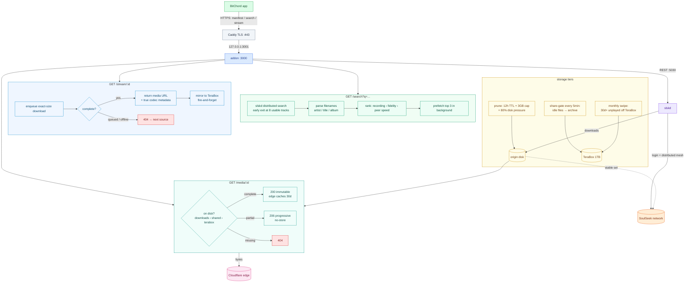

# soulseek-addon — BitChord addon for the SoulSeek network

BitChord talks to 3 `GET` routes on this server (`/manifest.json`, `/search`, `/stream/:id`).
SoulSeek has no HTTP API, so this server is a **gateway**: it logs into SoulSeek via
**slskd** (headless daemon — no desktop app needed) and serves the bytes back over HTTPS.



**One play, end to end:**

1. **Discover** — BitChord reads `/manifest.json` (addon id, resources, quality settings).
2. **Search** — `GET /search?q=…&quality=…` fans out to the SoulSeek distributed
   network via slskd (`POST /api/v0/searches {searchText}`, polled to completion,
   early exit at 8 usable tracks). Empty phrasing retries distinctive words
   automatically. Identical concurrent queries share one slskd search.
3. **Rank** — filenames are parsed path-aware (`Artist/Album/01 Title`,
   track-number stripping, quality-tag cleanup, never numeric "artists"), then
   ordered: exact recording → fidelity (hi-res lossless › ALAC › FLAC › HIGH by
   real bitrate › LOW) → peer speed (free upload slot first). Bitrates SoulSeek
   never reports are derived from file size ÷ duration, so every row carries an
   honest, BitChord-recognized tier.
4. **Prefetch** — the top 3 hits start downloading in the background immediately,
   so tapping play usually finds bytes already flowing.
5. **Stream** — `GET /stream/{id}` enqueues the peer download (exact byte size
   required), races up to 3 same-recording peers, returns the first complete
   file with true codec/container/sample-rate/bit-depth metadata. Deep peer
   queues fail fast to 404 so BitChord moves on.
6. **Play** — `GET /media/:id` serves bytes with Range + HEAD + correct MIME.
   Complete files send `Cache-Control: public, immutable` (edge caches them);
   partials send `no-store` (the edge must never learn a truncated song).

**Failure semantics (all deliberate):** unknown track → `404` (next source);
peer queued/offline → `404`; slskd throttled → `429 + Retry-After` (BitChord
backs off); empty search → `200 []` (soft miss). Nothing ever 500s on P2P flakiness.

---

## Contents

1. [Quickstart (mock — no SoulSeek, 30s)](#1-quickstart-mock--no-soulseek-30s)
2. [Real mode: going live with slskd](#2-real-mode-going-live-with-slskd)
3. [Add it in BitChord](#3-add-it-in-bitchord)
4. [Backends: mock / soulseek / terabox](#4-backends-mock--soulseek--terabox)
5. [TeraBox cache tier (SoulSeek backend)](#5-terabox-cache-tier-soulseek-backend)
6. [How to disable TeraBox](#6-how-to-disable-terabox)
7. [Sharing with SoulSeek (uploads)](#7-sharing-with-soulseek-uploads)
8. [Access control (token)](#8-access-control-token)
9. [Caching, storage upkeep, multi-user tuning](#9-caching-storage-upkeep-multi-user-tuning)
10. [VPS operations (systemd + justfile)](#10-vps-operations-systemd--justfile)
11. [Configuration reference](#11-configuration-reference)
12. [Is it working? (health checklist)](#12-is-it-working-health-checklist)
13. [Troubleshooting](#13-troubleshooting)
14. [Tests](#14-tests)

---

## 1. Quickstart (mock — no SoulSeek, 30s)

Zero setup. The server runs in **mock mode** whenever `SLSKD_URL` + `SLSKD_API_KEY`
are unset, serving a tiny fake catalogue with public sample MP3s so you can test
the BitChord contract end to end.

```bash
node src/server.js
# GET /manifest.json, /search?q=midnight, /stream/mock_midnight_signal
npm test            # 36 tests, should all pass
```

Add `http://localhost:3000/manifest.json` in BitChord: Settings → Sources.
(Mock streams are real playable MP3s; mock mode never touches SoulSeek.)

## 2. Real mode: going live with slskd

You need: a SoulSeek account, a host with Docker, and (for BitChord) an
HTTPS domain pointing at the host.

**Step 1 — SoulSeek account.** Create one in any SoulSeek client. slskd logs in
with `username + password`. Give every deployment its **own** account — two
simultaneous logins as the same user kick each other off.

**Step 2 — env.** Copy and fill the minimum:

```bash
cp .env.example .env
```

```ini
PUBLIC_BASE_URL=https://<your-host>   # absolute stream URLs come from this
SLSKD_URL=http://slskd:5030           # docker-compose service name
SLSKD_API_KEY=<long-random-hex>       # must match an api_keys entry in slskd.yml
ADDON_TOKEN=<long-url-safe-hex>       # optional but recommended (see §8)
```

slskd itself needs your SoulSeek credentials plus the same API key. Those live
in the slskd config (`slskd.yml`, persisted in the `slskd-data` volume):

```yaml
soulseek:
  username: <your-soulseek-user>
  password: <your-soulseek-password>
web:
  authentication:
    api_keys:
      soulseek-addon:
        key: <same-value-as-SLSKD_API_KEY>
        role: administrator
        cidr: 0.0.0.0/0,::/0
directories:
  downloads: /downloads
  incomplete: /downloads/incomplete     # must exist — slskd refuses to start without it
shares:
  directories:
    - /shared                            # what you publish back (see §7)
transfers:
  download: { slots: 15 }                # bound parallelism for a small box
  upload: { slots: 5 }
```

> **Never delete the `incomplete/` directory itself** (only its stale contents).
> slskd validates it on startup and exits `Invalid configuration` when it's
> missing. The repo's `prune.sh` / `share-gate.sh` explicitly exclude it — keep
> that exclusion if you ever rewrite them. (We learned this from a real
> outage: the prune deleted the empty dir, slskd crash-looped silently, and
> every search went empty.)

**Step 3 — launch.**

```bash
docker compose up -d        # slskd + addon, shared downloads/ volume
docker ps                   # both Up; slskd needs ~30s for first login
```

**Step 4 — verify before touching BitChord** (see full checklist in §12):

```bash
curl -s http://localhost:3000/health
# {"ok":true,"mock":false}  <- mock:false means real backend
```

## 3. Add it in BitChord

1. BitChord → Settings → Sources → Add an addon.
2. Paste the manifest URL:
   - **With token (recommended):** `https://<your-host>/<ADDON_TOKEN>/manifest.json`
   - Without token: `https://<your-host>/manifest.json`
3. Run BitChord's health check, then play representative tracks: a direct hit,
   a lossless upgrade, a miss (should fall through to the next source), and —
   if you enabled it — a download.

> Bare-domain URLs 401 when `ADDON_TOKEN` is set — **by design**. If BitChord
> says "that URL answered, but not with an addon manifest", you pasted the URL
> without the token prefix.

**Typical timing:** search 3–5s warm (distributed physics + early exit), stream
~2s warm / ~10s cold first fetch, media bytes edge-fast after first play.
First-ever searches after a restart are slower (cold mesh).

## 4. Backends: mock / soulseek / terabox

`ADDON_BACKEND` picks the source. Unset = auto: `terabox` when
`TERABOX_GATEWAY_URL` is configured, `soulseek` when slskd is configured,
`mock` otherwise.

| Backend | Source | Needs | Good for |
|---|---|---|---|
| `soulseek` | Live SoulSeek network via slskd | slskd + account | General use (default real mode) |
| `terabox` | **Your own** TeraBox shares via [terabox-gateway](https://github.com/saahiyo/terabox-gateway) | Gateway + catalog (below) | Personal library, no queues/slots/disk |
| `mock` | Built-in fake catalogue | Nothing | Wiring tests |

**TeraBox-library mode** (shows as `TeraBox Library` in BitChord): no queues,
direct CDN links, zero local disk. Links expire, so a fresh one is resolved
per `/stream` (never cached long-term).

```bash
# 1. run terabox-gateway (holds your TeraBox ndus cookie — see its README)
# 2. build the catalog from your music share URLs:
node scripts/build-terabox-catalog.mjs https://teraboxshare.com/s/XXXX ...
# 3. in .env:
ADDON_BACKEND=terabox
TERABOX_GATEWAY_URL=http://<gateway>:5000
```

## 5. TeraBox cache tier (SoulSeek backend)

Separate from §4: with the SoulSeek backend, TeraBox acts as a **second-level
cache**. SoulSeek fetches, TeraBox stores, repeat plays come from TeraBox.
Two archive paths (both fire-and-forget — playback never waits):

- **Instant:** the moment `/stream` confirms a complete file, it's mirrored to
  the TeraBox mount (no-clobber).
- **Backstop:** the quarantine gate (`share-gate.sh`, every 5 min) archives
  anything idle past `SHARE_DELAY_HOURS` (default **0** — settled ~a minute,
  never mid-write, never from `incomplete/`).

The addon serves all roots (`downloads/`, `incomplete/`, `shared/`,
`terabox/`); TeraBox files are complete-by-construction, so they serve
immutable and the edge caches them.

**Setup (on the host):**

```bash
# 1. install the rclone fork + configure the remote (needs your ndus cookie:
#    terabox.com → login → F12 → Application → Cookies → copy `ndus`)
NDUS='<your ndus cookie>' ./deploy/terabox-setup.sh
cp deploy/rclone-terabox-mount.service /etc/systemd/system/
systemctl enable --now rclone-terabox-mount   # mounts at /terabox

# 2. point the gate + addon at it
# prune.env:  SHARED_DIR=/terabox/soulseek   (gate destination)
# .env:       TERABOX_DIR=/terabox           (serve root)
```

Caveats: free-account uploads run ~1.5–3MB/s per file (a 50MB FLAC takes
~30s, async in background); the FUSE mount is a single point of failure
(systemd restarts it — watch `/var/log/rclone-terabox.log`); refresh the
`ndus` cookie when streams start failing.

## 6. How to disable TeraBox

Three independent switches — pick the level you mean. All take effect on
container restart (`docker restart soulseek-addon`, or `docker compose up -d`).

### Level A — kill-switch: whole TeraBox tier off (recommended)

In `.env` (or `prune.env` — same variable, either file works):

```ini
TERABOX_ENABLED=0
```

This disables **everything TeraBox**: serving from the mount, instant archive
mirrors, and the gate's TeraBox destination (the gate then keeps files in
staging for the normal prune lifecycle). SoulSeek keeps working exactly as
before; you just lose the second-level cache. Re-enable with `1` (or unset —
default is enabled when `TERABOX_DIR` is set).

Verify: play a track, then `docker logs soulseek-addon | tail` should show
**no** `terabox archived:` lines.

### Level B — stop serving/archiving, keep the mount

```ini
# .env: unset or empty
TERABOX_DIR=
```

The mount stays up for other uses, but the addon ignores it. Equivalent in
effect to Level A for this addon; use Level A if you might toggle back often.

### Level C — turn off TeraBox-*library* backend (§4), keep SoulSeek

```ini
# .env: remove the gateway (or force the backend explicitly)
#TERABOX_GATEWAY_URL=
ADDON_BACKEND=soulseek
```

Manifest flips back from `TeraBox Library` to your SoulSeek name. (BitChord
caches manifests ~10 min — remove + re-add the source in the app to see the
change instantly.)

### Level D — stop *sharing* the TeraBox archive with SoulSeek (uploads)

If you previously added `/terabox/soulseek` to slskd's shares and want it
private again (still served to BitChord, just not to SoulSeek peers):

1. In `slskd.yml`, remove the `- /terabox/soulseek` line under
   `shares: directories:` (keep `- /shared` if you still share that).
2. `docker restart slskd` (a rescan runs automatically).

| Goal | Change | Restart |
|---|---|---|
| Everything TeraBox off | `TERABOX_ENABLED=0` | addon |
| Addon ignores mount | `TERABOX_DIR=` (empty) | addon |
| Back to SoulSeek backend | `ADDON_BACKEND=soulseek` (+ unset gateway) | addon |
| TeraBox private from SoulSeek peers | remove from `slskd.yml` shares | slskd |
| Remove the mount entirely | `systemctl disable --now rclone-terabox-mount` + Level B | host |

## 7. Sharing with SoulSeek (uploads)

By default only `/shared` is published to the network. Finished downloads can
be quarantined first: the gate promotes only files idle past
`SHARE_DELAY_HOURS` into the share dir; playback is unaffected either way.

To also share the TeraBox archive (what it takes — don't skip steps):

1. The slskd container must see the mount (read-only is enough and safer).
   In `docker-compose.override.yml` (VPS-local, not committed):
   ```yaml
   services:
     slskd:
       volumes:
         - /terabox:/terabox:ro
   ```
2. In `slskd.yml`:
   ```yaml
   shares:
     directories:
       - /shared
       - /terabox/soulseek     # SoulSeek-originated archive only —
                               # NOT all of /terabox (that would publish
                               # your whole personal library)
   ```
3. `docker compose up -d slskd` (recreates the container), then confirm:
   `docker logs slskd | grep "Sharing /"` shows both roots and the scan
   completes (`Sharing N directories and M files`).

Trade-off, stated plainly: every archived file becomes uploadable to SoulSeek
peers through a FUSE mount on a small box. Upload slots are capped at 5 —
leave them capped.

## 8. Access control (token)

Optional. Set `ADDON_TOKEN` (URL-safe hex) and **every** addon route — manifest
included — moves under `/<token>/...`; bare paths `401`. Stream URLs embed the
prefix, and the token ships as the manifest's `token` default, which BitChord
forwards automatically.

Honest scope: stops scanners and drive-by use, **not** someone holding a full
prefixed URL. True revocation = rotate the token — old URLs die instantly
because the path itself changes:

```bash
# .env: set a fresh token, restart, use the new manifest URL in BitChord
ADDON_TOKEN=<new-hex>
docker restart soulseek-addon
```

Server logs never include the token (only query text + timings).

## 9. Caching, storage upkeep, multi-user tuning

**Caching, layer by layer** (each layer only sees misses from the one above):

| Layer | What | TTL |
|---|---|---|
| BitChord app | search 10 min, stream 5 min | client-side |
| Addon memory | search hits, stream bodies (empties never cached) | 10 / 5 min |
| Origin disk | downloaded files | 12h idle + 3GB cap + 80% disk-pressure eviction |
| Cloudflare edge | immutable `/media/*` | 30d + tiered PoPs |

**Origin prune** (`deploy/prune.sh`): deletes files neither read nor written in
`TTL_HOURS` (default 48; 12h with edge on), enforces a `MAX_MB` cap, and evicts
oldest-played-first past `DISK_MAX_PCT` (default 80). No cron needed:
`deploy/prune-monitor.sh` (via `soulseek-prune-monitor.service`) checks disk
every 60s and runs the prune on every threshold crossing (flock-guarded).
A monthly swipe (`soulseek-terabox-swipe.{service,timer}`) expires 30d+-unplayed
files from TeraBox, oldest first (`SKIP_STAGING=1` keeps it off local disk).

Configure via `prune.env`: `TTL_HOURS, MAX_MB, DISK_MAX_PCT, DATA_DIR,
SHARED_DIR, SHARED_TTL_HOURS, SHARED_MAX_MB, STAGING_DIR, SHARE_DELAY_HOURS,
TERABOX_ENABLED, SKIP_STAGING, MOUNT, CHECK_SECS`.

**Edge cache (Cloudflare, free tier, 2 min):**

1. Cache Rule: host = your addon host, path `/media/*` → Cache Everything,
   Edge TTL ~1 month, honor origin TTL (so `no-store` partials never cache).
2. Turn on Tiered Cache (Smart).
3. Verify: `curl -I <media-url>` twice → second has `CF-Cache-Status: HIT`.

**Multi-user (50–100 users on 1–2 vCPU):** bursts are shed, not queued.
`MAX_SEARCHES` (4) / `MAX_STREAMS` (12): excess gets instant `429 +
Retry-After`, which BitChord honors. Prefetch pauses under load and for 60s
after any failure. Identical concurrent searches coalesce. Cap slskd
`transfers.download.slots` (~15) / upload (~5). Comfortable box: 2 vCPU /
2GB RAM / 25GB+ disk (~$6–12/mo tier). Listener count barely matters (edge
absorbs repeats); distinct new songs per minute is the real load metric.

## 10. VPS operations (systemd + justfile)

`just` (no args) lists everything. VPS recipes ssh as root; override with
`VPS_HOST` / `VPS_SSH_USER`.

```bash
just dev                    # run locally (mock unless .env set)
just test                   # npm test
just check                  # syntax-check sources + scripts
just vps-status             # containers, disk, memory
just vps-slskd              # SoulSeek login + mesh state
just vps-health             # manifest over public HTTPS
just vps-search "query"     # search the live addon
just vps-logs               # addon + slskd tails
just vps-deploy             # ship src to VPS, restart addon
just vps-prune              # run origin prune now
just vps-disk               # cache sizes + prune log tail
```

Systemd units (`deploy/*.service|*.timer`, logs to `/var/log/soulseek-prune.log`
unless noted):

| Unit | Schedule | What |
|---|---|---|
| `soulseek-gate.timer` | every 5 min | share-gate: archive idle downloads |
| `soulseek-prune.timer` | every 30 min | prune + gate pass |
| `soulseek-prune-monitor.service` | always-on | event-driven prune on disk pressure |
| `soulseek-watchdog.service` | always-on | restarts slskd/addon on failed health (5-min cooldown; `/var/log/soulseek-watchdog.log`) |
| `soulseek-terabox-swipe.timer` | monthly | expire old TeraBox files |
| `rclone-terabox-mount.service` | always-on | the `/terabox` FUSE mount |

## 11. Configuration reference

All runtime config is env (see `.env.example`); `.env` is optional, env wins.

| Variable | Default | Meaning |
|---|---|---|
| `PORT` | 3000 | Addon listen port (inside container) |
| `PUBLIC_BASE_URL` | `http://localhost:$PORT` | Absolute base for stream/media URLs — **must be `https://…` in production** |
| `ADDON_BACKEND` | auto | `soulseek` \| `terabox` \| `mock` |
| `SLSKD_URL` / `SLSKD_API_KEY` | — | slskd REST endpoint + key (both unset → mock mode) |
| `DOWNLOAD_DIR` | `./downloads` | slskd's finished-download dir (shared volume) |
| `INCOMPLETE_DIR` | `<parent>/incomplete` | Partial downloads (served progressively). **Must exist; never delete the dir itself** |
| `SHARED_DIR` | — | Stable share dir for the gate (empty = disabled) |
| `TERABOX_DIR` | — | TeraBox rclone mount (empty = tier disabled) |
| `TERABOX_ENABLED` | 1 | `0` kills the whole TeraBox tier (serve + archive) |
| `TERABOX_GATEWAY_URL` | — | TeraBox-library backend gateway (sets backend to `terabox`) |
| `TERABOX_CATALOG` | `./terabox.catalog.json` | Local gateway-catalog index |
| `SEARCH_TIMEOUT_MS` | 8000 | Distributed-search collection window |
| `STREAM_WAIT_MS` | 20000 | How long `/stream` waits for first bytes before 404 |
| `MAX_SEARCHES` / `MAX_STREAMS` | 4 / 12 | Load-shedding caps (429 + Retry-After past these) |
| `PREFETCH_N` | 3 | Background prefetches per search (`0` = off) |
| `ADDON_ID` / `ADDON_NAME` / `ADDON_VERSION` | dev.soulseek.addon / … | Manifest identity |
| `ADDON_TOKEN` | — | Path-prefix access token (empty = open) |

## 12. Is it working? (health checklist)

Run top to bottom; stop at the first failure — that's your layer.

```bash
# 1. processes
docker ps | grep -E "slskd|soulseek-addon|caddy"   # all Up; slskd (healthy)
# 2. resources
df -h / | tail -1; free -m | head -2 | tail -1    # disk <80%, some free RAM
# 3. slskd login + mesh (needs SLSKD_API_KEY from .env)
#    want: server "Connected, LoggedIn", distributedNetwork hasParent true
# 4. addon (no token needed for /health)
curl -s http://localhost:3001/health              # {"ok":true,"mock":false}
# 5. public manifest (token URL -> 200, bare -> 401 when token set)
curl -s -o /dev/null -w "%{http_code}\n" https://<host>/<token>/manifest.json
# 6. public search -> 200 with tracks[] (allow ~10-60s cold)
# 7. public stream -> 200 with url+codec, or 404 (peer miss = normal)
# 8. public media HEAD -> 200 audio/* + immutable; Range -> 206
```

In BitChord: re-add the source with the **full token URL** after any outage
(the app caches manifests/searches ~10 min), run its health check, play one
warm track and one cold track.

## 13. Troubleshooting

| Symptom | Likely cause | Fix |
|---|---|---|
| slskd `Restarting` loop, dies in ~1s, `Invalid configuration: … Incomplete … non-existent` | `incomplete/` dir deleted (old prune/gate did this when empty) | `mkdir -p <downloads-volume>/incomplete`; upgrade prune/gate (they now exclude it); `docker restart slskd` |
| slskd exits silently, no logs, rapid restarts | Same as above (output lost to the restart race) — attach once to see it: `docker stop slskd && docker start -a slskd` | Fix the reported error, then start normally |
| `No space left on device` mid-download while `df` shows free space later | Parallel Hi-Res bursts filled the disk transiently (or prune freed it after) | Lower `transfers.download.slots`, shorten `TTL_HOURS`, run `just vps-prune`; size disk for bursts, not averages |
| Addon logs all `search failed: fetch failed`, searches return `[]` | slskd unreachable (down / restarting) | Fix slskd first (§12 steps 1–4) |
| Manifest `401` | Token set, URL missing the `/<token>/` prefix | Use the full token manifest URL everywhere (BitChord entry, stream URLs) |
| "URL answered, but not with an addon manifest" in BitChord | Same 401, or pasted root URL that doesn't resolve | Paste the exact `/manifest.json` URL you curled to 200 |
| BitChord shows stale/empty results after an outage | App + addon memory caches (10/5 min) | Restart addon (clears server cache); remove + re-add source in BitChord (clears app cache) |
| `/stream` 404s on everything | All candidate peers queued/offline, or deep queues (fail-fast by design) | Normal P2P weather — try another track; if *persistent*, check slskd login/mesh (§12 step 3) |
| `429` on search/stream | Load shedding (`MAX_*`) or slskd throttled | Wait out `Retry-After`; scale box or raise caps if sustained |
| TeraBox streams failing suddenly | `ndus` cookie expired | Refresh the cookie (terabox.com → F12 → Cookies), update rclone.conf, restart mount |
| Share scan finds 0 files after editing shares | Rescan timing / empty dirs | Check `docker logs slskd \| grep "Sharing /"`; ensure shared dirs exist and are mounted |

## 14. Tests

```bash
npm test            # node --test tests/ — parsing, ranking, auth, cache, gates, terabox
```

Version-specific slskd API quirks are isolated in `src/slskd.js →
enqueueDownload()`; file serving only assumes the shared `DOWNLOAD_DIR`.
BitChord protocol details: the [addon developer guide](https://bitchord.kushagrasingh.in/docs).
Spec compliance notes: stable opaque ids, absolute HTTPS URLs, honest codec
fields (never overstated — unknown stays `LOW`), `404` = miss, `429` +
`Retry-After` = back off, stereo fallback when no Dolby mix exists.
